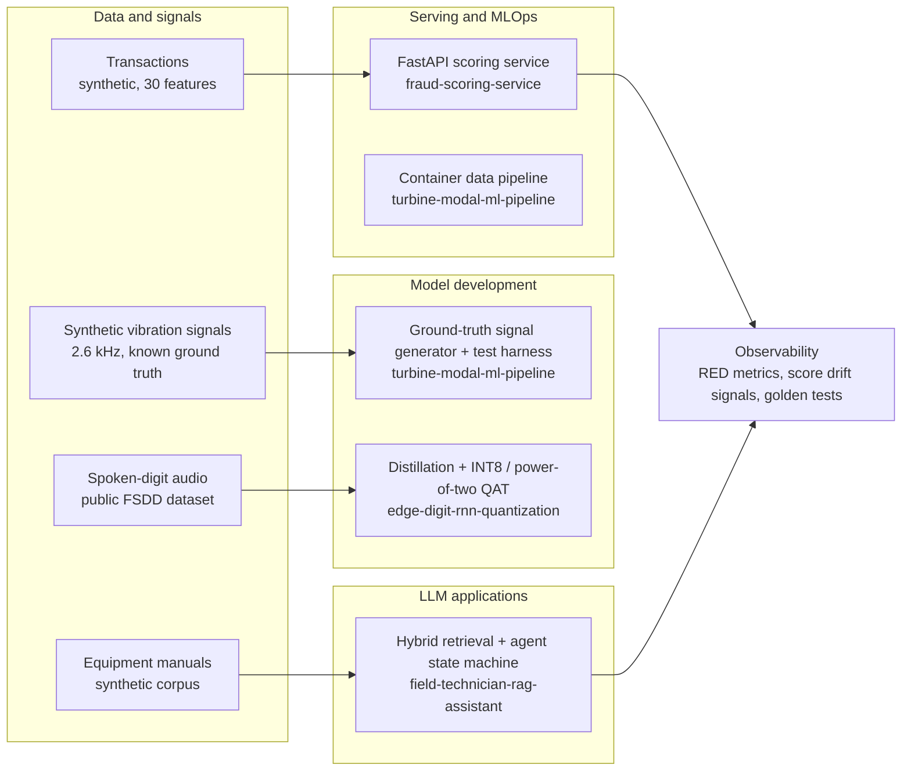

# AI / ML Engineer Portfolio


Machine-learning and AI engineering work, built to be read: each project has a design rationale, tests,
and numbers that say how they were measured. My focus, in order: **ML engineering**, **AI engineering**,
**data science**.

> **Data policy.** No real data, documents, credentials or configuration is included: everything runs on public or
> synthetic data. Two projects, `field-technician-rag-assistant` and `turbine-modal-ml-pipeline`, are **sanitised
> releases of work done for a client and an employer**, published with their permission and with identifying details removed;
> their READMEs say exactly what that means. Where a project reports numbers, its README says how they were produced.

## The four core projects

| Project | Fit | What it demonstrates | Stack | Status |
|---|---|---|---|---|
| [`fraud-scoring-service`](./fraud-scoring-service) | **MLE** | Serving a scikit-learn model as a production service: integrity-checked model loading, readiness gating, latency engineering, observability, deployment design | FastAPI, Docker, Prometheus, scikit-learn | Available (one-off `make demo-model`, see its README) |
| [`edge-digit-rnn-quantization`](./edge-digit-rnn-quantization) | **DS / applied ML** | Compressing a recurrent classifier under hard hardware limits: knowledge distillation, INT8 and power-of-two quantization-aware training, acceptance tests | PyTorch, librosa | Available |
| [`field-technician-rag-assistant`](https://github.com/Zoroaster-BGAE/field-technician-rag-assistant) | **AI Eng** | An AI-agent MVP: hybrid retrieval, a code-owned agent state machine, grounded answers with citations, admin trace viewer | FastAPI, Postgres + pgvector, Claude API, React + TypeScript | Available (sanitised release, see its README) |
| [`turbine-modal-ml-pipeline`](https://github.com/Zoroaster-BGAE/turbine-modal-ml-pipeline) | **MLE / DS** | A container data pipeline for sensor files on S3, and a synthetic vibration generator with known ground truth plus tests that recover the known modes | NumPy / SciPy, pandas, Docker, boto3 | Available (sanitised release, see its README) |

## Architecture overview

How the projects fit the ML lifecycle, from data to serving to monitoring:



## Profiles

### ML engineering
- **Production serving.** `fraud-scoring-service` verifies the model's SHA-256 before unpickling, refuses a
  scikit-learn version mismatch by reading the pickle's opcode stream (never executing it), warms the model before
  readiness returns 200, and pins threads for a 1-vCPU container.
- **Verified optimisation.** A faster single-row scoring path ships only because a test proves it matches stock
  scikit-learn output exactly, and a switch turns it off.
- **Operability.** Prometheus RED metrics plus score-distribution and decision-rate signals (inputs for drift
  monitoring), a golden-score contract test, and load-test tooling.
- **Pipelines and test data.** `turbine-modal-ml-pipeline`: a containerised pipeline that selects and concatenates
  sensor files from S3, and a synthetic ground-truth generator for testing estimators without real data.

### AI engineering
- **Hybrid retrieval.** Vector similarity (pgvector, HNSW) and Postgres full-text search, fused with Reciprocal
  Rank Fusion, so exact alarm codes and paraphrased symptoms both retrieve.
- **Agent design.** The agent's control flow (answer, expand, ask, escalate) and every budget are code, not prompt.
  The model decides inside each node; the flow is testable with a scripted model.
- **Safety by construction.** Retrieval scope is pinned in SQL and cannot be widened by the model; a verbatim guard
  stops the assistant from reproducing source text; every answer carries citations.
- **Engineering.** Schema-constrained Claude API calls, a React chat UI with an admin trace viewer, and a test suite
  of 100+ tests that needs no API key.

### Data science
- **Model compression** (`edge-digit-rnn-quantization`): distillation from a GRU teacher into a minimal-gated-unit
  student under a per-layer memory limit, then quantization-aware training.
- **Time series and signal processing** (`turbine-modal-ml-pipeline`): a structural-vibration generator with known
  ground truth (modal responses, rotor harmonics, drift, noise at a set SNR) and tests that recover the known
  frequencies and mode shapes from spectral estimates. The estimators themselves are not in the repository.
- **Earlier analytics work** is kept below.

## Project notes

### `fraud-scoring-service`
Real-time scoring API (`POST /fraud-score`, batch endpoint, health and metrics endpoints) for a 15-tree random
forest. The README works through where latency goes, what was done about it, how to size and deploy it on ECS Fargate,
and how to monitor the model and not only the service. The shipped model is a **synthetic stand-in** trained by
`scripts/train_demo_model.py`; its README states which numbers were measured on an earlier reference model.

### `edge-digit-rnn-quantization`
Spoken-digit classification with four models under progressively stricter constraints: an unconstrained GRU teacher,
a 36 kB-per-layer float32 student, INT8 quantization-aware training, and power-of-two weights. Includes the
quantization utilities (hand-written straight-through estimators), per-layer memory auditing, and an eight-check
validation notebook. **Known issue:** the INT8 run scores below the power-of-two run, which is the wrong way round;
diagnosing it is on the roadmap.

### [`field-technician-rag-assistant`](https://github.com/Zoroaster-BGAE/field-technician-rag-assistant)
A sanitised release of an AI-agent MVP that helps a technician troubleshoot industrial equipment from that machine's
own manuals. The technician picks a client and machine, and the agent retrieves only from that scope, then answers
with citations or asks one clarifying question. Names are replaced with placeholders and the manuals are a fictional,
generated corpus. It is not a clean-room rebuild, and the repository README says what was and was not changed.

### [`turbine-modal-ml-pipeline`](https://github.com/Zoroaster-BGAE/turbine-modal-ml-pipeline)
A sanitised release of a container data pipeline written for an employer (it selects healthy sensor files per day
and speed bin and concatenates them), plus a **synthetic vibration generator written from scratch** and MIT-licensed:
damped modes with known frequency, damping and mode shapes, rotor harmonics, drift, and noise at a set SNR, with
tests that recover the known modes and mode shapes from the signal. The mode-clustering pipeline and the cloud
deployment code are not included.

## Earlier work

| Folder | What it is |
|---|---|
| [`BayesianChessBot`](./BayesianChessBot) | Chess engine comparing a deep and a Bayesian neural-network evaluator, plus a fog-of-war variant with Dempster-Shafer uncertainty estimation |
| [`DF.Docs`](./DF.Docs) | Data-foundations assignment: data selection and cleaning, modelling and SQL, in R |
| [`DVisualisation_Journalist_Deaths`](./DVisualisation_Journalist_Deaths) | Interactive map built for a data-visualisation assignment, on a public journalists dataset |

## Repository layout

```
AI-ML-Engineer-Portfolio/
├── fraud-scoring-service/            MLE: model serving and observability
├── edge-digit-rnn-quantization/      DS: distillation and quantization-aware training
├── BayesianChessBot/                 earlier work
├── DF.Docs/                          earlier work
├── DVisualisation_Journalist_Deaths/ earlier work
└── README.md
```

The other two core projects live in their own repositories:
[`field-technician-rag-assistant`](https://github.com/Zoroaster-BGAE/field-technician-rag-assistant) and
[`turbine-modal-ml-pipeline`](https://github.com/Zoroaster-BGAE/turbine-modal-ml-pipeline).

## Running things

| Project | Needs | Commands |
|---|---|---|
| `fraud-scoring-service` | Docker, `make` | `make demo-model && make golden && make test && make build && make run` |
| `edge-digit-rnn-quantization` | Python 3.10+ | `pip install -r requirements.txt`, then follow the project README (dataset clone, then `python main.py`) |
| `turbine-modal-ml-pipeline` | Python 3.10+ | `pip install -r requirements.txt && pytest` (tests the synthetic generator) |
| `field-technician-rag-assistant` | Docker, a Claude API key | see the project README |

## What's next

- CI on every project (lint, type-check, tests, container build).
- An evaluation harness for the retrieval agent: retrieval ablations, threshold calibration, false-answer rate.
- A SageMaker deployment adapter for the scoring service.
- Resolve the INT8 quantization result.

## Contact

GitHub: [@Zoroaster-BGAE](https://github.com/Zoroaster-BGAE)
